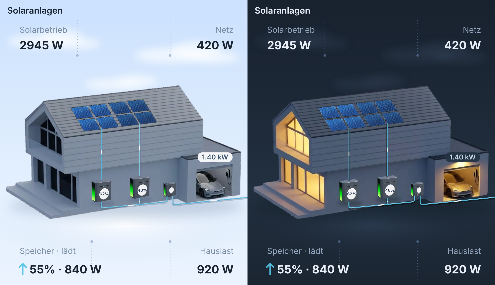

# Sonnendeck

Eine Lovelace-Karte für Home Assistant, die den Energiefluss eines Haushalts als ein
Bild zeigt: ein Haus mit PV-Modulen auf dem Dach, Solarbanks an der Wand,
Hausanschluss und Garage mit Wallbox — mit animierten Flusslinien. Haus und Geräte sind
Bilder (Tag und Nacht, Auto in der Garage oder unterwegs), alles, was einen Zustand
trägt, liegt als Vektor darüber.

Gebaut für Balkonkraftwerke mit Speicher, insbesondere für **Anker SOLIX** über die
[anker_solix](https://github.com/thomluther/ha-anker-solix)-Integration; mit manuell
eingetragenen Entitäten läuft sie an jeder anderen Anlage genauso.

**Du wählst ein Gerät, den Rest findet die Karte selbst.** Zeig auf ein
`anker_solix`-System und sie liest alle Sensoren aus der Entity-Registry — auch die
von Hardware, die später dazukommt, etwa eine zweite Solarbank oder ein Power Dock.

**Alle Systeme in einem Bild.** Die App zeigt immer nur ein System, weil sie muss.
Hier steht ein Haus für den ganzen Haushalt: jede Solarbank bekommt ihren eigenen
Block aus vier Modulen auf dem Dach — einen je MPPT-Eingang — und darunter ihren
eigenen Speicher mit Ladestand auf der Scheibe. Die Blöcke stehen **immer nebeneinander**, und jeder
Speicher steht genau unter seinem Block — damit ist jedes Kabel ein senkrechter
Strich in die richtige Batterie, ohne Kreuzungen und ohne Nachdenken. Jedes Modul wird je nach Leistung seines Eingangs heller oder dunkler (volle Sonne ab
`panel_peak`, Standard 400 W), ein verschatteter oder abgeklemmter String fällt also
sofort auf. Kommt ein **Power
Dock** dazu, verschmelzen die Speicher zu einem Gerät und die Ladestände wandern
als Reihe darüber.

Wer keine Anker-Integration nutzt, trägt die Entitäten von Hand ein: die Karte ist
darunter vollständig entity-agnostisch und läuft genauso mit Shelly, Tibber, MQTT
oder Template-Sensoren.



---

## Installation

### HACS (empfohlen)

1. HACS → **Frontend** → ⋮ → **Custom repositories**
2. Repository: `https://github.com/dirknoelke/sonnendeck-card`, Kategorie: **Lovelace**
3. „Sonnendeck" installieren
4. Home Assistant neu laden (Strg+F5), dann die Karte über **Karte hinzufügen** suchen

### Manuell

`dist/sonnendeck-card.js` nach `config/www/` kopieren und als Ressource eintragen
(Einstellungen → Dashboards → ⋮ → Ressourcen, erweiterter Modus muss an sein):

```yaml
url: /local/sonnendeck-card.js?v=0.8.0
type: module
```

Die Versionsnummer in der URL bei jedem Update hochzählen — sonst hält der Browser
die alte Datei fest.

### Umstieg von `anker-solix-flow-card`

Bis 0.7.4 hieß die Karte `anker-solix-flow-card`. Der alte Elementname bleibt
registriert, bestehende Dashboards laufen also unverändert weiter — nur die
Ressource muss auf `sonnendeck-card.js` zeigen. Wer aufräumen mag, ersetzt in
seinem YAML `type: custom:anker-solix-flow-card` durch `type: custom:sonnendeck-card`.

---

## Konfiguration

Im Regelfall reicht das hier — beim Anlegen über die UI trägt die Karte alle
gefundenen Systeme sogar selbst ein:

```yaml
type: custom:anker-solix-flow-card
systems:
  - device: 8d1f0c3a9b7e4d52a1c6f0b3e7d94a15   # Mini-PV Dach
  - device: 2c7b48e6d0fa4913b85e1c7d6a03f942   # Mini-PV Garten
```

### Optionen

| Option           | Typ      | Standard | Beschreibung |
|------------------|----------|----------|--------------|
| `systems`        | Liste    | –        | Ein Eintrag je Anker-System, siehe unten |
| `title`          | string   | –        | Optionale Überschrift über der Grafik |
| `dock`           | string   | –        | Geräte-ID des Power Docks. Gesetzt heißt: ein Speicher statt vier |
| `house`          | map      | –        | Hauszähler, siehe unten. Gewinnt gegen die Werte aus den Systemen |
| `wallbox`        | map      | –        | Wandladestation, siehe unten. Gesetzt heißt: Garage mit Wallbox, das Auto steht drin, solange es lädt |
| `panel_peak`     | number   | `400`    | Leistung eines Eingangs in W, ab der sein Modul voll sonnig gezeichnet wird |
| `house.load`     | string   | –        | Optional. Ohne Angabe wird die Hauslast aus der Bilanz berechnet |
| `combine`        | map      | –        | `grid` und `home`: `primary` (Standard) oder `sum`, siehe unten |
| `storage_display`| string   | `auto`   | `units` je System ein Speicher, `combined` einer für alle, `auto` schaltet um sobald ein Power Dock da ist |
| `invert_grid`    | boolean  | `false`  | Vorzeichen des Netz-Sensors drehen |
| `invert_battery` | boolean  | `false`  | Vorzeichen des Batterie-Sensors drehen |
| `animation`      | boolean  | `true`   | Laufende Punkte auf den Flusslinien |
| `show_badge`     | boolean  | `true`   | Leistungs-Pille auf der Leitung Speicher → Haus |
| `kw_threshold`   | number   | `0`      | Ab diesem Wert in W wird auf kW umgestellt (`0` = immer W) |
| `dark_mode`      | string   | `auto`   | `auto` (folgt dem HA-Theme), `light`, `dark` |
| `labels`         | map      | –        | Überschreibt `solar`, `grid`, `home` |

### Ein System

| Feld          | Beschreibung |
|---------------|--------------|
| `device`      | Geräte-ID des Anker-**Systems**. Eine Solarbank geht auch — die Karte klettert dann eine Ebene hoch zum System. |
| `name`        | Fallback-Beschriftung, wenn kein Gerätename gefunden wird |
| `device_name` | Beschriftung unter dem Speicher. Standard: der Name der Solarbank bzw. des Power Docks |
| `entities`    | Manuelle Overrides, gewinnen gegen alles Gefundene |

---

## Wie die Erkennung funktioniert

Die Karte liest die Entity-Registry und ordnet Sensoren über ihren
`translation_key` zu — der ist sprachunabhängig, anders als Entity-IDs. Berücksichtigt
werden das gewählte Gerät **und alle Geräte, die über es angebunden sind**. Genau
deshalb erscheint eine zweite Solarbank oder ein nachgerüstetes Power Dock ohne
Änderung an der Konfiguration.

| Rolle             | `translation_key`, in dieser Reihenfolge |
|-------------------|------------------------------------------|
| PV gesamt         | `solar_power_total`, `solarbank_input_power`, `input_power` |
| PV 1–4            | `solar_power_1` … `solar_power_4` |
| Netz              | `grid_power_signed` |
| Hauslast          | `home_load_power`, `ac_to_home_load` |
| Ladestand         | `solarbank_state_of_charge`, `state_of_charge_total`, `state_of_charge` |
| Batterieleistung  | `solarbank_battery_power_signed`, `battery_power_signed_total`, `battery_power_signed` |
| Ausgang           | `solarbank_output_power`, `ac_output_power_total`, `output_power_total`, `ac_output_power` |
| PV → Haus         | `pv_to_home_power` |
| PV → Speicher     | `pv_to_battery_power` |
| Speicher → Haus   | `battery_to_home_power` |
| Netz → Speicher   | `grid_to_battery_power` |
| Netz → Haus       | `grid_to_home_power` |
| Einspeisung       | `photovoltaic_to_grid_power` |

Findet die Karte keinen Treffer, fällt sie auf ein Muster im Entity-ID zurück
(`home_load_power`, `state_of_charge`, `grid_power` und so weiter). Für alles andere
gibt es die manuellen Overrides.

### Hauszähler

Der Zähler gehört zum Haus, nicht zu einer Solarbank. Wer einen eigenen hat —
Tasmota mit SML-Lesekopf, Shelly 3EM, ein Template-Sensor — trägt ihn einmal
zentral ein:

```yaml
house:
  grid_import: sensor.tasmota_sml_in    # Bezug in W
  grid_export: sensor.tasmota_sml_out   # Einspeisung in W
```

Alternativ ein einzelner vorzeichenbehafteter Sensor:

```yaml
house:
  grid: sensor.shelly_3em_total_power   # + Bezug / − Einspeisung
```

Wichtig: **Momentanleistung in Watt**, nicht der kWh-Zählerstand. Ein SML-Lesekopf
liefert oft beides — für die Karte ist der Leistungswert (OBIS 16.7.0) der richtige,
nicht die Zählwerke 1.8.0 und 2.8.0. Erkennt die Karte eine Energieeinheit
(`Wh`, `kWh`, `MWh`), verwirft sie den Wert und sagt es unter der Grafik, statt eine
plausible Zahl anzuzeigen, die keine ist. `kW` wird automatisch umgerechnet.

### Die Hauslast wird gerechnet, nicht gemessen

Ein Hausanschluss misst nur, was über die Grenze geht. Was im Haus verbraucht wird,
ist eine Bilanz:

```
Hauslast = was die Solarbanks ins Hausnetz abgeben  +  Netzbezug  −  Einspeisung
```

Deshalb ist die Hauslast regelmäßig **größer als der Netzbezug** — der Teil, den die
Speicher liefern, läuft nie über den Zähler. An einem Zählpunkt schließen sich Bezug
und Einspeisung gegenseitig aus, es trägt also immer nur einer der beiden Terme bei.

Die Karte rechnet das selbst, sobald ein Hauszähler konfiguriert ist. `house.load`
ist nur für den Fall da, dass du einen echten Verbrauchssensor hast — dann gewinnt
der.

### Wallbox und Auto

Ist eine Wandladestation konfiguriert, kommen Stellplatz, Fahrzeug und Ladesäule
rechts ins Bild, mit einer Leitung vom Zählerkasten dorthin. Die Karte wird dafür
breiter; ohne Wallbox bleibt die Szene unverändert.

```yaml
wallbox:
  device: 7a2e5c91b3d84f06a2e9c1b7d4f83a52   # V1 Smart EV Charger
```

Das Gerät genügt — Ladeleistung und Status werden daraus gelesen. Alternativ von
Hand, wobei die drei Phasen addiert werden:

```yaml
wallbox:
  power_l1: sensor.wallbox_power_l1
  power_l2: sensor.wallbox_power_l2
  power_l3: sensor.wallbox_power_l3
  status: sensor.wallbox_status
```

Die Ladeleistung erscheint als Pille über dem Auto, ab 1 kW in Kilowatt — eine
Wallbox in Watt zu lesen hilft niemandem.

#### Woran die Wallbox hängt

| Feld     | Standard | Bedeutung |
|----------|----------|-----------|
| `source` | `dock`, sobald ein Power Dock eingetragen ist, sonst `house` | `dock`: die Leitung zweigt von der AC-Schiene ab, weil das Dock einen eigenen Anschluss für die Wallbox hat. `house`: sie geht vom Zählerkasten weg wie ein normaler Hausstromkreis |

Mit Dock kommt also alles aus einem System: die Module laden die Speicher, das Dock
versorgt Haus und Auto aus derselben Schiene.

#### Das Auto zählt nicht zur Hauslast

Der Wagen hängt hinter dem Zähler, also taucht er in der Bilanz auf — egal ob er am
Dock oder an einem Hausstromkreis lädt. Damit „Hauslast" den Haushalt meint und
nicht Haushalt plus Auto, wird die Ladeleistung wieder abgezogen:

```
Hauslast = Σ AC-Ausgang + Netzbezug − Einspeisung − Ladeleistung
```

Die Pille am Auto zeigt den Wagen, die Hauslast unten rechts den Rest. Sollte dein
Ausgangssensor das Auto bereits nicht mitzählen, stell `in_home_load: false` —
sonst wird doppelt abgezogen.

### Netz und Hauslast bei mehreren Systemen

Zwei Anker-Systeme im selben Haus schauen meist auf denselben Zähler. Ihre
Netz- und Hauslastwerte zu addieren würde also doppelt zählen. Deshalb nimmt die
Karte beide Werte standardmäßig vom **ersten System, das einen liefert**:

```yaml
combine:
  grid: primary   # oder: sum
  home: primary   # oder: sum
```

Auf `sum` stellen, wenn deine Systeme wirklich getrennte Zähler und getrennte
Verbrauchskreise haben. Mit einem `house`-Zähler ist das ohnehin erledigt — der
gewinnt gegen beide Varianten. PV-Erzeugung und Batterieleistung werden immer summiert,
der Ladestand ist der Mittelwert über die Speicher.

### Die vier Eckwerte

| Ecke | Wert |
|------|------|
| Solarbetrieb | Summe der PV-Eingänge aller Systeme |
| Netz | Betrag am Zählpunkt; die Richtung steckt in der Flusslinie |
| Speicher | Mittlerer Ladestand · **Betrag** der Batterieleistung |
| Hauslast | Σ AC-Abgabe + Netzbezug − Einspeisung − Auto |

Die Watt-Zahl beim Speicher ist die **Batterieleistung**, also der Fluss *in die*
oder *aus den* Zellen — nicht die Abgabe ans Haus. Ob geladen oder entladen wird,
steht als Wort in der Überschrift (`Speicher · lädt` / `Speicher · entlädt`) und
im Pfeil daneben. `844 W` bei `lädt` heißt: alle Speicher zusammen nehmen gerade
844 W auf. Was davon ins Haus geht, steht in der Hauslast.

Antippen öffnet nur dann eine Entität, wenn es genau eine gibt. Solarbetrieb und
Speicher sind bei mehreren Systemen Summen — dort würde ein Klick willkürlich
System 1 öffnen. Der Weg ins Einzelsystem führt über die Ladestands-Pille am
jeweiligen Speicher.

### Woraus die Flusslinien entstehen

Sind die Teilfluss-Sensoren da, zeigt jede Linie genau ihren Sensor — nichts wird
geraten:

Die Leitungen folgen dem realen Aufbau statt einem Schema:

| Leitung | von → nach | aktiv bei |
|---------|------------|-----------|
| DC, je Solarbank | Modulblock → zugehöriger Speicher | Erzeugung dieses Systems > 10 W |
| Stich, je Speicher | Speicher → AC-Schiene | Wechselrichter-Ausgang dieses Speichers außerhalb ±10 W |
| AC-Schiene | Speicherreihe → Zählerkasten | Summe außerhalb ±10 W |
| Netz | Mast → Zählerkasten | Netzleistung außerhalb ±10 W |

Der AC-Wert eines Speichers ist der **Wechselrichter-Ausgang**
(`output`, ersatzweise `pv_to_home + battery_to_home`), abzüglich `grid_to_battery`.
Nur `battery_to_home` zu nehmen wäre falsch: an einem sonnigen Tag lädt der Speicher,
während die Module das Haus direkt versorgen — die Leitung führt dann Strom, obwohl
die Batterie nichts abgibt.

Negative Werte kehren die Laufrichtung um: lädt ein Speicher aus dem Netz, läuft
sein Stich rückwärts; wird eingespeist, läuft die Netzleitung nach außen. Steht ein
Wert bei 0 W, bleibt die Leitung grau und ruhig — das ist kein Fehler, sondern die
Aussage.

Die Animation ist ein einzelner Puls, der die **ganze** Leitung durchläuft. Über
`pathLength="1000"` wird jede Strecke auf dieselbe Länge normiert — kurze Stiche
und die lange Schiene laufen dadurch im Gleichtakt, unabhängig von der Pixellänge.

---

## Manuelle Entitäten

Alles unterhalb von `entities` ist optional und überschreibt die Erkennung:

| Schlüssel | Einheit | Vorzeichen |
|-----------|---------|------------|
| `solar`, `solar_1` … `solar_4` | W | – |
| `grid` | W | **+ Bezug / − Einspeisung** |
| `home` | W | – |
| `battery_soc` | % | – |
| `battery_power` | W | **+ laden / − entladen** |
| `output` | W | + zum Haus |
| `pv_to_home`, `pv_to_battery`, `battery_to_home`, `grid_to_battery`, `grid_to_home`, `home_to_grid` | W | + in Pfeilrichtung |

Stimmen die Vorzeichen deines Zählers nicht, dreh sie mit `invert_grid` bzw.
`invert_battery` — die Karte rechnet nichts um, sie liest nur ab.

---

## Anpassen

Alle Farben sind CSS-Variablen auf dem Host-Element:

```yaml
card_mod:
  style: |
    :host {
      --ak-roof-1: #7a5c46;
      --ak-roof-2: #5d4433;
      --ak-flow: #f2a33c;
      --ak-accent: #f2a33c;
    }
```

Die wichtigsten: `--ak-sky-1..4`, `--ak-roof-1/2`, `--ak-panel-1/2`, `--ak-wall-1/2`,
`--ak-flow`, `--ak-flow-idle`, `--ak-accent`, `--ak-text`, `--ak-muted`,
`--ak-badge-bg`, `--ak-badge-fg`.

---

## Entwicklung

Die Karte kommt **ohne Laufzeit-Abhängigkeiten** aus — kein Lit, kein Bundler.
Home Assistant lädt genau eine Datei.

```bash
npm install     # nur TypeScript
npm run build   # src/*.ts  ->  dist/sonnendeck-card.js
npm run watch
```

Die Grafik ist **konstruiert, nicht nachgezeichnet**. Alle Punkte laufen durch
dieselbe isometrische Projektion:

```
screen = O + x·(1, K) + y·(−1, K) + h·(0, −1)
```

`+x` läuft nach rechts unten (Firstrichtung), `+y` nach links unten (Gefällerichtung),
`+h` nach oben, `K = 0.28` ist die Abflachung. Dadurch ist der First per Konstruktion
parallel zur Traufe, die Dachfläche lässt sich lückenlos mit Modulen kacheln, und
alles steht auf einer gemeinsamen Grundebene bei `h = 0` — mit Kontaktschatten,
damit nichts schwebt. Die abgewandte Dachfläche wird gar nicht erst gezeichnet: bei
dieser Kamera ist sie nicht sichtbar.

Hausmaße, Modulraster und die Speicherreihe stecken in `HOUSE`, `UNIT` und
`panelMarkup()` — dort ändern, nicht in einzelnen Pfaden.

## Lizenz

MIT — siehe [LICENSE](LICENSE).

**Sonnendeck ist ein unabhängiges Projekt.** Es steht in keiner Verbindung zu
Anker Innovations und wird von dort weder betrieben noch unterstützt oder geprüft.
„Anker" und „SOLIX" sind Marken von Anker Innovations und werden hier ausschließlich
genannt, um zu beschreiben, mit welcher Hardware die Karte zusammenarbeitet.

## Bilder

Haus und Geräte liegen als WebP in `art/` und werden mit `npm run art` in
`src/art.ts` eingebettet, damit die Karte eine einzige Datei bleibt (`npm run build`
fügt beides zusammen). Ein Bild tauschen: Datei in `art/` ersetzen, `npm run art`,
`npm run build`. Die vier Hausbilder müssen denselben Ausschnitt haben, die zwei
Modulbilder (dunkel und sonnig) ebenfalls.
